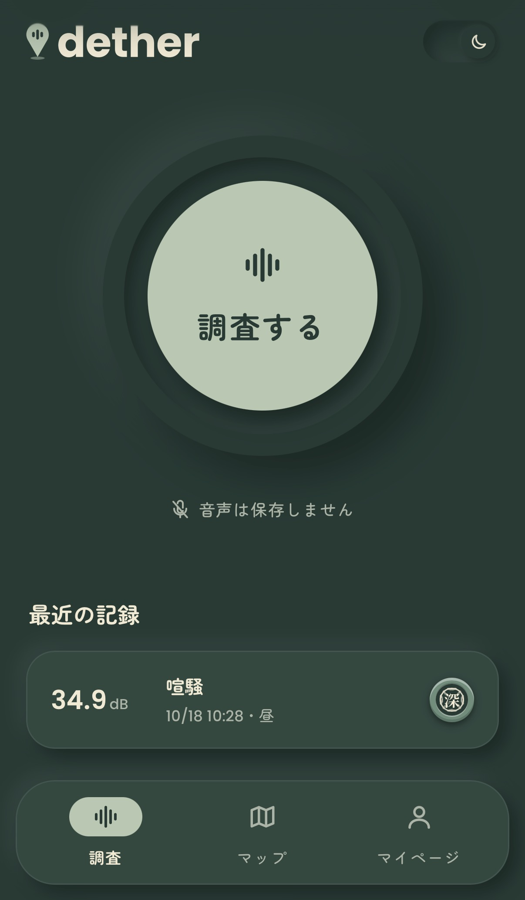
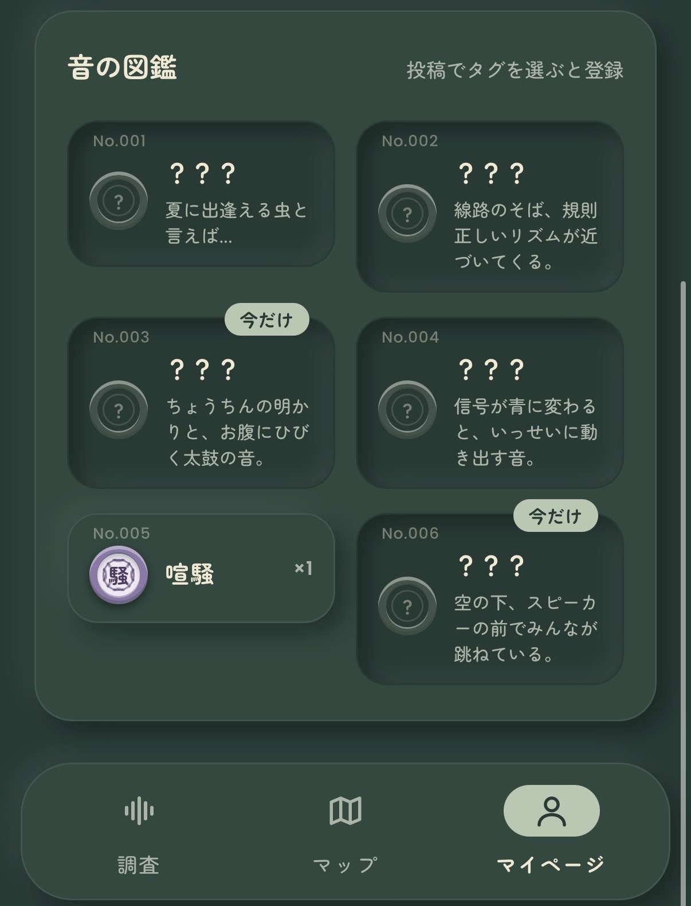
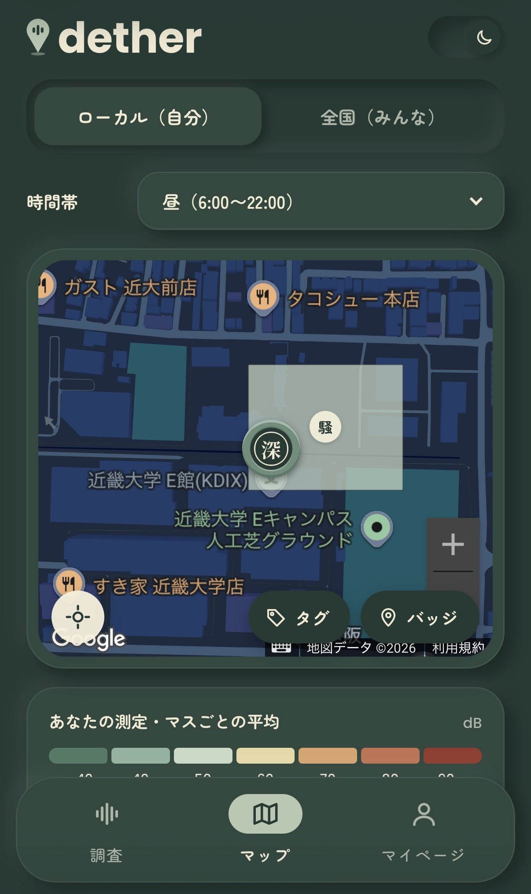
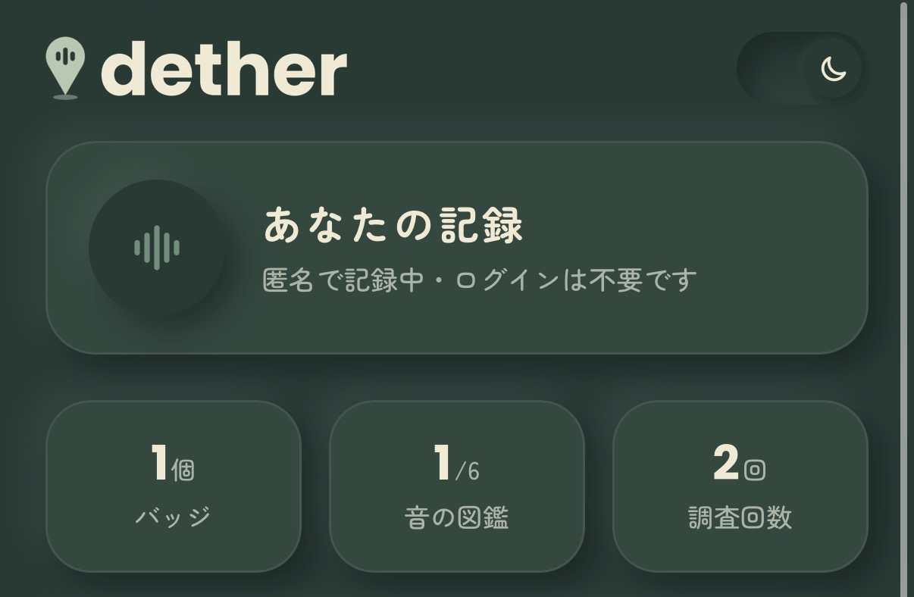
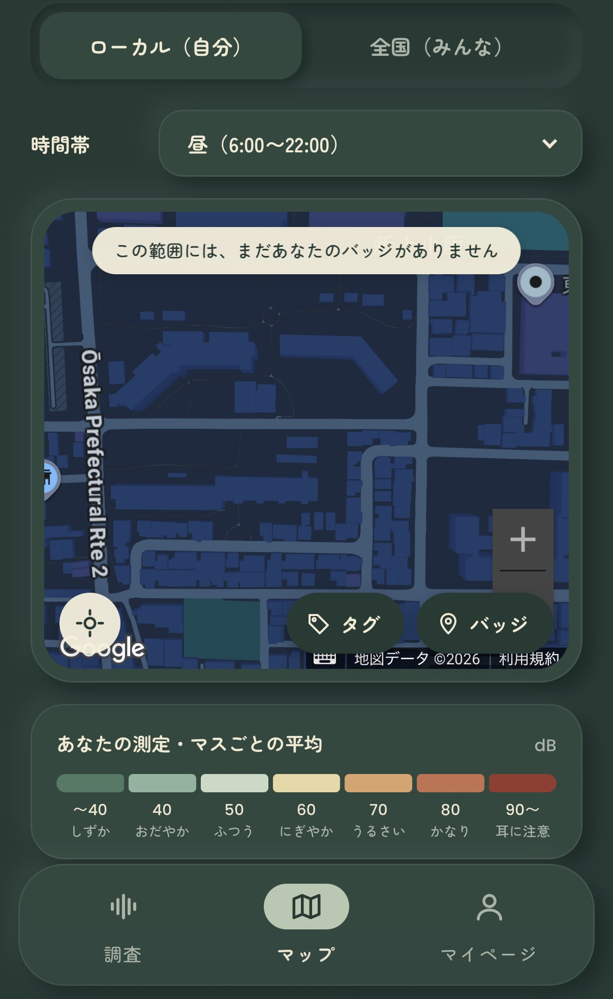

# dether（ディーザー）

**街の音を、集めて、見える化する。**

スマホで街の音を測り、バッジや音のタグを集める位置情報ゲーム。

あなたの発見が、みんなでつくる音環境マップになります。

> JPHACKS2026 | X-Tech 2026 ～ Full Stack Hackers ～ · Team AIB

[アプリを体験する](https://dether.mrrn.jp/) · [デモ動画を見る](docs/readme-assets/demo.mp4) · [体験の流れ](#体験の流れ) · [3つの特長](#3つの特長) · [技術的な工夫](#技術的な工夫) · [開発資料](#開発資料)

<table>
  <tr>
    <th width="33%">街の音を測る</th>
    <th width="33%">音の図鑑を埋める</th>
    <th width="33%">発見を地図で見る</th>
  </tr>
  <tr>
    <td valign="top"></td>
    <td valign="top"></td>
    <td valign="top"></td>
  </tr>
</table>

**[▶ 実際の操作を動画で見る（MP4・約5.6MB）](docs/readme-assets/demo.mp4)**

動画はリンク先で開くか、ダウンロードして再生できます。[アプリはこちらから体験できます](https://dether.mrrn.jp/)。

## 体験の流れ

| ① 測る | ② 集める・投稿する | ③ 地図で見る |
| --- | --- | --- |
| 立ち止まって「調査する」。周囲の音量をリアルタイムで確認。 | 音量と時間の条件でバッジを獲得。聞こえた音をタグ・文章・写真で記録。 | 自分の記録とみんなの投稿を切り替え、音量の色分けや音の種類を確認。 |

登録操作なしで始められます。バッジを獲得していない測定にも投稿でき、集めたバッジやタグはマイページの図鑑で振り返れます。

マイページ・マップの画面も見る

**マイページ：集めたバッジ・音の図鑑・調査回数をひと目で確認。**

**マップ：自分／みんなの記録と時間帯を切り替えて探索。**

## 3つの特長

### 静けさも、発見になる

大きな音だけでなく、静かな場所でもバッジを獲得できます。5種類のバッジを昼夜それぞれで収集。同じ散歩道でも、時間帯を変えると違う発見があります。

### 音を、自分だけの標本に

測定した音のスペクトルを、メダルの模様に反映します。音量の数字に加えて、音の特徴を見た目として持ち帰る体験です。共通タグや季節限定タグを集め、音の図鑑を埋めていきます。

### 発見が、街の地図になる

ヒートマップでは、約50mの区画ごとの音量を色で、最も多く記録された音のタグを代表タグとして表示します。バッジ獲得に至らなかった測定も集計に利用。季節の音の表示も切り替えられ、遊びながら残した記録が、街の音環境を知る手がかりになります。

## なぜつくったのか

街の音環境は、訪れてみるまでわかりにくく、音量だけでは何の音かも伝わりません。一方、さまざまな場所の情報を継続して集めるには、参加する楽しさが必要です。

そこで、**「音を測って集めるゲーム」を、街の音量と音の種類を記録する仕組みにつなげました。** 静かな場所探しや、地域の季節・文化を発見するきっかけを目指しています。

## 技術的な工夫

| 工夫 | 体験・効果 | 主な実装 |
| --- | --- | --- |
| 音量とスペクトルの解析 | 音量をリアルタイム表示し、16帯域の特徴からメダルの模様を生成 | [測定](static/js/measure.js)・[メダル描画](static/js/badge.js) |
| 音量・時間・昼夜による判定 | 大きな音と静けさを収集対象にし、履歴を保存 | [測定API](main/api_measure.py)・[保存処理](main/measure_store.py) |
| 半径50mの表示調整 | 自分の地図では同系統・同時間帯の強いバッジを優先。元の記録は保持 | [50mルール](main/badges.py) |
| 約50m区画の音量集計と描画 | 固定区画の平均音量をCanvasで表示。屋外の記録は周辺を補間し、屋内の記録はその区画だけに表示 | [集計API](main/api_heatmap.py)・[地図描画](static/js/map.js) |
| 期間付きのタグと図鑑 | 毎年の出現期間や年またぎに対応し、収集する楽しさをつくる | [モデル](main/models.py)・[タグ一覧](main/tag_data.py) |
| 匿名アカウントと写真処理 | 登録操作を省き、投稿写真は縮小・再保存してEXIFを除去 | [ユーザー管理](main/middleware.py)・[投稿API](main/api_posts.py) |

測定区間の音量はエネルギー平均（Leq）で計算し、ヒートマップは各測定の推定dB値を算術平均して表示します。Google MapsのOverlayViewとCanvasを使い、標準のHeatmapLayerには依存しません。

**測定した区画は濃く、屋外データから補間した周辺区画は薄く表示します。** 周辺の色は、その場所で実測した値ではありません。調査画面で屋内／屋外を選択でき、屋内の記録は周辺への補間に使いません。

バッジの獲得条件（初期設定）

| バッジ | 判定区間の条件 |
| --- | --- |
| 90dB | 10秒間の推定平均音量が90dB以上 |
| 80dB | 10秒間の推定平均音量が80dB以上 |
| 70dB | 10秒間の推定平均音量が70dB以上 |
| 静寂 | 15秒間の推定平均音量が40dB以下 |
| 深い静寂 | 15秒間の推定平均音量が33.5dB以下 |

静寂系は判定中に直近1秒の音量がしきい値を超えると取り消します。深い静寂への挑戦は、その調査で静寂バッジを獲得した後に始まります。

昼は6:00〜22:00、夜は22:00〜翌6:00。獲得条件と時間帯は管理画面で変更できます。判定の詳細は[測定API資料](docs/API_measurement.md)を参照してください。

## 現在できること・今後の展望

音の測定・保存、バッジ判定、タグ・文章・写真の投稿、ローカル／全国マップ、ヒートマップ、音の図鑑を実装しています。音量の補正値はiOS・Android・PCで切り替えています。

次の展開として、以下を検討しています。

- **端末ごとの測定精度の検証・補正の改善**：実機での比較を重ね、音環境を比較するための信頼性を高める。
- **データの引き継ぎ**：機種変更やブラウザのデータ削除に備える。
- **地域限定タグと時間変化の可視化**：地域の音や季節ごとの変化を楽しめる体験へ広げる。

## 利用にあたって

- スマートフォンのブラウザで、マイクと位置情報の許可が必要です。実機利用ではHTTPS環境を使用します。
- 音量は補正値を用いた推定値で、端末や環境によって異なります。校正済み騒音計と同等の精度を保証するものではありません。
- 音声そのものは保存・送信せず、音量・スペクトルの特徴量・位置情報などを保存します。
- 全国マップの投稿ピンには測定位置が表示されます。位置情報のぼかしは未実装です。ヒートマップには投稿の有無にかかわらず測定が集計されます。
- 匿名アカウントはブラウザのセッションで識別します。データの引き継ぎは未実装です。
- 調査は安全な場所に立ち止まって行い、大きな音や危険な場所へ近づかないでください。

## 開発資料

**構成：** HTML / CSS / JavaScript · Python 3.13 / Django 5.2 LTS · MySQL 8.4

**地図・測定：** Google Maps JavaScript API · Web Audio API · Geolocation API

**開発・本番向け構成：** Docker Compose · uv · Nginx / Gunicorn · Let's Encrypt

| 資料 | 内容 |
| --- | --- |
| [環境構築・日々の操作](docs/SETUP.md) | 開発環境の準備と起動手順 |
| [デプロイ手順](docs/DEPLOY.md) | 本番環境・HTTPSの設定 |
| [測定API](docs/API_measurement.md) | 測定結果の送受信と判定ルール |
| [ヒートマップAPI](docs/API_heatmap.md) | 区画の仕様と集計API |

---

   
  <strong>Team AIB</strong> 
  JPHACKS2026

